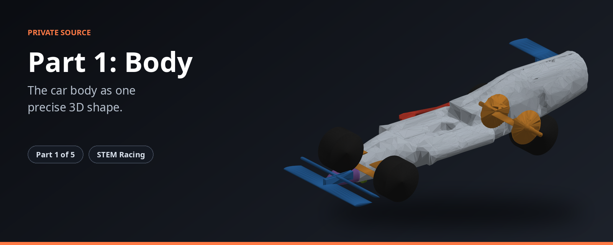

<p align="center"></p>

> The car body as one precise 3D shape.

> **Status 2026-11-09:** the plan is carving from the block. How to build and test this part, with its rules and pass marks: `BUILD_SPEC.md` (in the private repo). Old work is kept read-only as `archive/*` tags.

| | |
|---|---|
| **What it is** | The milled body of a STEM Racing car as one labelled shape with every rule applied. |
| **Source** | Private |
| **Public overview** | https://github.com/Shashanksaraswat123939/stem-racing-overview |

**The STEM Racing set**

| Part | Repository |
|---|---|
| 1 | [part1-simulation](https://github.com/Shashanksaraswat123939/part1-simulation) |
| 2 | [part2-simulation](https://github.com/Shashanksaraswat123939/part2-simulation) |
| 3 | [part3-simulation](https://github.com/Shashanksaraswat123939/part3-simulation) |
| 4 | [part4-simulation](https://github.com/Shashanksaraswat123939/part4-simulation) |
| 5 | [part5-simulation](https://github.com/Shashanksaraswat123939/part5-simulation) |

---

The milled body of a STEM Racing car as ONE labelled level-set field on a 1 mm
grid, with every rule that shapes it applied as a hard mask, and the parametric
"hybrid" body the search draws into that field.

| module | what |
|---|---|
| `geometry_contract.py` | every dimension and density the parts share (grid spacing, wheel radius, cargo, densities) |
| `unified_phi.py` | the one field: build the envelope with the rule masks (T4.2 cargo, T5.5 cartridge wall, halo pocket, ballast area, T7.9 wheel zones, model block), symmetry, remap, mass from sub-cell volume fractions, half-surface extraction |
| `param_body.py` | the hybrid body: an 8-station superellipse loft, sidepods, a smooth blend and 32 sculpt modes, drawn into the field, made machinable, and sized by a uniform skin offset to a mass target |
| `machining.py` | the team's process on the grid: 6.25 mm ball end from top, bottom, left and right; every concave corner gets the cutter radius, rule-required air is grown until the ball can reach it |
| `fixed_hardware.py`, `hardware_geometry.py`, `halo_pocket.py`, `virtual_cargo.py`, `wheel_visibility_zones.py`, `bounding_volumes.py` | the fixed parts (cartridge, halo, wheels, cargo) and the masks they impose; `hardware_cad/` holds the team's STLs |
| `phi_updater.py` | level-set updates and reinitialisation (used by the body sizing; the adjoint-driven descent it was written for failed its gradient check) |
| `surface_extraction.py`, `stl_assembler.py`, `quality_gates.py`, `mass_com_calculator.py` | marching-cubes surfaces, the CFD-ready half STL, the quality gates Part 3 runs |
| `ballast.py` | the T3.6 target (48.2 g) and the ballast rules; the team adds no ballast, the body volume carries the mass |
| `coarse.py` | run the pipeline at another grid spacing (1 mm for the search, 0.3 mm production) |

Carving the block with the level set is the plan again (2026-11-08). The lofted
parametric body still builds, and any field can be carved and finished with
`param_body.build(..., field_mm=...)`. The rules are the 2026-27 regulations PDF
(same text as 2025-26).

```bash
pip install -r requirements.txt
python -m pytest tests -q
```
