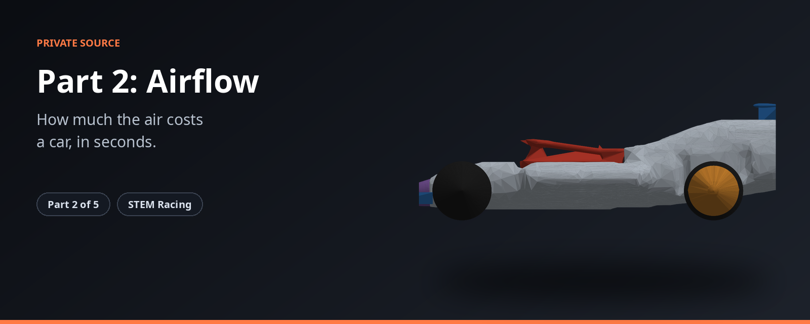

<p align="center"></p>

> How much the air costs a car, and what it means.

> **Status 2026-11-09:** the plan is carving from the block. How to build and test this part, with its rules and pass marks: [`BUILD_SPEC.md`](BUILD_SPEC.md). Old work is kept read-only as `archive/*` tags.

| | |
|---|---|
| **What it is** | Airflow simulation for a half car, and the race time model that turns drag into seconds. |
| **Source** | Private |
| **Public overview** | https://github.com/shawshanker18/stem-racing-overview |

**The STEM Racing set**

| Part | Repository |
|---|---|
| 1 | [part1-simulation](https://github.com/shawshanker18/part1-simulation) |
| 2 | [part2-simulation](https://github.com/shawshanker18/part2-simulation) |
| 3 | [part3-simulation](https://github.com/shawshanker18/part3-simulation) |
| 4 | [part4-simulation](https://github.com/shawshanker18/part4-simulation) |
| 5 | [part5-simulation](https://github.com/shawshanker18/part5-simulation) |

---

| module | what |
|---|---|
| `openfoam_case.py` | the forward CFD case for a half car on ESI OpenFOAM v2412: domain (3 lengths ahead, 8 behind, symmetry plane, moving ground), snappyHexMesh with wake boxes, k-omega SST, Spalding wall function or a wall-resolved (y+ <= 2) layer stack, every Part 4 part as its own patch (wheels as rotating walls), forces per patch, y+ distribution per patch |
| `cfd_wrapper.py` | `run_half_car_cfd`: validate the STL, run the case, return full-car drag and lift with health (residual, standard error and drift of the force mean); `run_half_car_adjoint` for the drag adjoint |
| `openfoam_adjoint.py` | the adjoint case (`adjointOptimisationFoam`, frozen turbulence). Not trusted yet: its first check had the right sign on only 3 of 8 settings. Part 3 must prove it, fix it, or replace it with measured slopes |
| `race_objective.py` | the differentiable race-time model (JAX): thrust curve, rolling and aero drag, wheel inertia. The thrust curve and the centre-of-mass penalties are placeholders until the team measures them |
| `race_objective_adapter.py`, `adjoint_contract.py` | the objective's parameter vector, guarded evaluation, and the drag weight dT/dD20 |
| `physics_contract.py`, `mass_com_ingest.py`, `candidate_record.py` | units and the half-car contract, mass and COM of the whole car, one JSON record per candidate |

Resolutions (`resolution=`): `coarse`, `medium` (the search mesh, ~0.65 M cells with the
wake boxes, ~30 min on 4 cores), `fine` (~4.4 h), `resolved` (~5 M cells, wall-resolved,
over GitHub's 6 h limit). Race-time noise for a tiny shape change is about 1 ms today;
cutting it is part of `BUILD_SPEC.md`.

```bash
pip install -r ../part1-simulation/requirements.txt
python -m pytest tests -q
```
