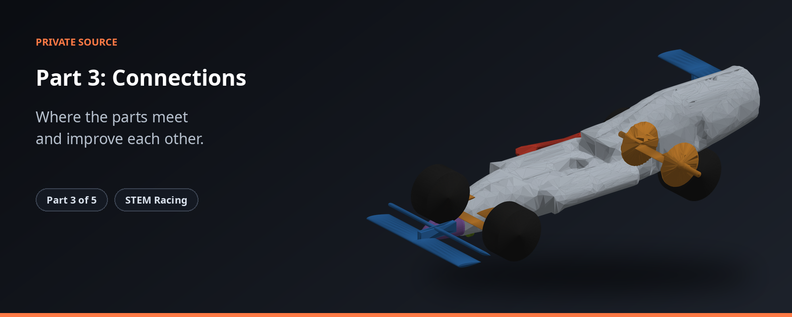

> Where the parts meet and improve each other.

> **Status 2026-11-09:** the plan is carving from the block. How to build and test this part, with its rules and pass marks: `BUILD_SPEC.md` (in the private repo). Old work is kept read-only as `archive/*` tags.

| | |
|---|---|
| **What it is** | The connections between Parts 1 and 2, and the loop that improves one body. |
| **Source** | Private |
| **Public overview** | https://github.com/shawshanker18/stem-racing-overview |

**The STEM Racing set**

| Part | Repository |
|---|---|
| 1 | [part1-simulation](https://github.com/shawshanker18/part1-simulation) |
| 2 | [part2-simulation](https://github.com/shawshanker18/part2-simulation) |
| 3 | [part3-simulation](https://github.com/shawshanker18/part3-simulation) |
| 4 | [part4-simulation](https://github.com/shawshanker18/part4-simulation) |
| 5 | [part5-simulation](https://github.com/shawshanker18/part5-simulation) |

---

## The compass

A map over the car's surface: how much the race time changes if each bit of surface moves
outward (`dT_dn`, s per m of outward move per m^2). Part 1 cuts along `-dT_dn`. Status and
pass marks: `BUILD_SPEC.md` (in the private repo); run links and numbers: `PROOF.md` (when done).

**Which map.** The fast adjoint map failed its known-answer test (below), so the compass is the
**measured map** (BUILD_SPEC 7 Step 4, 12.7): Gaussian surface modes, each measured by central
difference, combined into a map by least squares. The adjoint stays a side study.

| module | what |
|---|---|
| `compass.py` | `race_slope`: dD/dn, dL/dn and Part 2's race slopes to `dT_dn` under constant mass (projection weighted by how far Part 1's skin sizing moves each vertex); `save` / `load` of `compass.npz` |
| `checks/known_answer.py` | 2-D wing known-answer test: adjoint settings, test shapes, measured-map modes, step rehearsal |
| `checks/car_sign.py` | adjoint on real cars: nose sign, coverage of the map, flow settling |
| `checks/compare_maps.py` | is a car's map the same from different points of its flow's cycle? |
| `checks/race_slopes_check.py` | Part 2's race slopes against its own race time |
| `pipeline_interface.py`, `optimizer_contract.py` | shared bindings and types used by Part 5's `run_car.py` |

**Conventions.** + = grow the solid (outward normal). OpenFOAM's wall normal points into the
solid, so `openfoam_adjoint.OUTWARD_SIGN = -1` is applied once when the map is read. Frame:
x rearward from the nose tip, y outward from the centreline (right half), z up, metres.
Constant mass: `dT_dn = g - <g>_wA` with `w` the skin weight (1 on free surface, ~0 where rule
zones or block faces hold the surface); `g` adds drag, lift, mass and centre-of-mass terms.

**What the wing showed (2026-11-09/10).**
- Adjoint as coded: wrong sign on 20/20 bumps (OpenFOAM's normal), fixed. Primal stopped early
  by an fvSolution residual target, fixed. Both fixes are in `openfoam_adjoint.py`.
- Even fixed, the adjoint map fails: r 0.5 to 0.7 on the coarse mesh, worse on a finer one, and
  OpenFOAM's own full setup at its design Reynolds number reaches only 0.42 to 0.55. The simple
  surface formula is about 66x too large (not a units error: unchanged at half speed); the full
  formula has the right size but the same poor pattern.
- Measured map (40 modes): r 1.00 on its own family, r 0.94 / signs 90% on 20 shapes outside it;
  also passes on a 4x finer mesh and with 80 smaller modes. Limit: features narrower than about
  half a mode.
- Step rehearsal: one step down the measured map lowers drag for steps up to about 1.5 mode
  heights (best -0.67%), and raises it from about 3: cuts must stay inside that trust size.

Tests: `python -m pytest tests -q` (GitHub only: `p3_tests.yml`). The five repositories sit
side by side.
