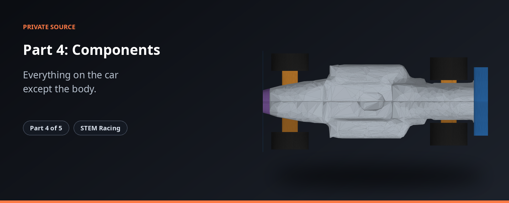

<p align="center"></p>

> Everything on the car except the body.

> **Status 2026-11-10:** the plan is carving from the block. Results and run links: [`PROOF.md`](PROOF.md). How to build and test this part is in the private repo. Old work is kept read-only as `archive/*` tags.

| | |
|---|---|
| **What it is** | Wheels, wings, supports, nose and joints, with their rule checks and manufacturing files. |
| **Source** | Private |
| **Public overview** | https://github.com/shawshanker18/stem-racing-overview |

**The STEM Racing set**

| Part | Repository |
|---|---|
| 1 | [part1-simulation](https://github.com/shawshanker18/part1-simulation) |
| 2 | [part2-simulation](https://github.com/shawshanker18/part2-simulation) |
| 3 | [part3-simulation](https://github.com/shawshanker18/part3-simulation) |
| 4 | [part4-simulation](https://github.com/shawshanker18/part4-simulation) |
| 5 | [part5-simulation](https://github.com/shawshanker18/part5-simulation) |

---

Everything on the car that is not the milled body, as exact parametric geometry
with regulation gates, CFD patches, a mass rollup and the manufacturing files.

| module | what |
|---|---|
| `component_contract.py` | every regulation number used (T3, T6, T7, T8, T9) |
| `wheel.py` | the team's wheel STLs in SLS PA12 with a 6 mm seat for one 3x6x2.5 bearing: mass and inertia measured from the mesh, and the closed spinning disc the CFD uses in their place |
| `beam_support.py` | the team's support architecture, parametric: one PA12 part per axle, a hollow pod in a channel milled from below, plate, strip, disc, boss, printed 3 mm stub and hubcap, sized for the load case in the file; T7.12.1, T3.7 and load gates |
| `wings.py` | NACA front wing with flap, rear wing and pylon, scrutineer-style gates |
| `nose.py` | printed nose cone ahead of Ref A (a PA12 shell) |
| `joints.py` | printed positives glued into milled negatives: a ball-end-safe pocket per part, the printed part that fills it, and the manufacturing files |
| `assembly.py` | all parts for one car: right-half STL per CFD patch, `extra_surfaces` for Part 2, `fixed_hardware_kwargs` for the mass rollup, gates |

```bash
python assembly.py --body body_half.stl --out parts/
python -m pytest tests -q
```

## Manufacturing files (`joints.make_all`)

Written to `manufacture/`, in **millimetres**, both halves, one closed solid per part:

| file | what | material |
|---|---|---|
| `machined_body.stl` | the body as milled: every pocket cut, ending at Ref A | foam, 0.163 g/cm3 |
| `printed_front_assembly.stl` | nose cone (hollow shell with bulkhead and a 3 mm powder drain, or solid when `wall_mm` leaves no cavity), front wing, flap and mount, and the tenon: ONE part, because the wing mount runs through the cone | PA12 |
| `printed_support_front.stl`, `printed_support_rear.stl` | one part per axle: beam, stub axles, disc, the keel that fills the drop-in channel, and that axle's tether guide | PA12 |
| `printed_rwing.stl` | rear wing and pylon, trimmed at the body surface (surface-bonded: no pocket fits over the cartridge wall) | PLA |
| `printed_wheel_front_x2.stl`, `printed_wheel_rear_x2.stl` | the team wheels with the bearing seat (print two of each) | PA12 |

No two of these occupy the same space. Before 2026-09-30 the nose, front wing, front
tether guide and front support were four overlapping files, and 0.85 cm3 of overlap
was counted twice in the mass.

`make_all` re-reads every file it writes and reports whether it is a closed solid
with the expected number of pieces, and its mass. `manufactured_g` is the sum: with
the wheels, bearings and halo it is the car's mass on the scale, which is what
Part 5 sizes the body against and checks T3.6 with.

## Evidence behind the defaults

GitHub Actions CFD, medium mesh, all parts in the flow: wheels are about 64 % of the
car's drag. Front wing at +6 deg with an 8 mm flap at 30 deg; minimum-section rear
wing. The v2 rear wheel-support CAD bottoms out at 1.40 mm, 0.10 mm under T3.7, and
its 12.7 mm disc blocks the T7.13 hang-test claw; the parametric beam support uses a
12.0 mm disc.

## Other outputs per car

| file | what | who reads it |
|---|---|---|
| `manufacture/parts_list.csv` | every made file with its material and process (foam = CNC mill, 1.01 g/cm3 = PA12 SLS, 1.24 g/cm3 = PLA FDM) and mass; the team wheels are listed but are the team's own files | the team |
| `mass_report.json` (`assembly.write_mass_report`) | `car_weight_kg` (car plus the empty cartridge shell, no CO2), centre of mass, wheel inertia, the cartridge's rear centre and axis height, the tether line height, per-part masses, and which masses are placeholders | Part 2's race model |

## Print minimum

One number, `component_contract.MIN_WALL_MM` (default 0.7 mm; the `P4_MIN_WALL_MM`
environment variable overrides it, and the `p4_cars` / `p4_lab` workflows take it as
`min_wall`). It sets the support and hubcap walls, the nose shell, and a blunt wing
trailing edge of that width. Reference cars at 0.7, 1.0 and 1.2 mm are all legal
(PROOF.md). Set it to the team printer's figure when it is known.

## The referee (`part5-simulation/legality.py`)

Part 4 owns the independent rule check. It measures the finished car from its files,
like a scrutineer with plug gauges, and shares no code or numbers with Part 1's cutter:

- `rules_constants.py`: every rule number, typed from the regulation pages.
- `RULES_MAP.md`: each rule, the check that judges it, or the reason it can't be
  checked from geometry (113 rows, no gaps).
- `tests/test_rules_edges.py`: for every numeric rule, a car just inside passes and a
  car just outside fails on that rule's id.
- `tests/test_independence.py`: no imports from Part 1, and Part 1's numbers
  cross-checked against the referee's own.

Each check gives a margin (≥ 0 passes) and a note that says where it failed.

## Running it (GitHub only)

| workflow | what |
|---|---|
| `p4_tests` | Part 4 and Part 5 unit tests |
| `p4_cars` | the reference cars through the referee, at a chosen print minimum |
| `p4_assembly` | a batch of carved or lofted cars, built and judged, plus a summary job (`label` = canary or official) |
| `p4_summary` | re-summarise a finished batch |
| `p4_lab` | one experiment script from `.github/lab/` |
