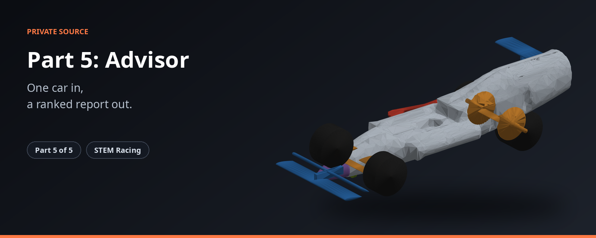

<p align="center"></p>

> One car in, a ranked report out.

> **Status 2026-11-09:** the plan is carving from the block. How to build and test this part, with its rules and pass marks: `BUILD_SPEC.md` (in the private repo). Old work is kept read-only as `archive/*` tags.

| | |
|---|---|
| **What it is** | Runs a car through all five parts, checks it against the rules and writes the recommendations. |
| **Source** | Private |
| **Public overview** | https://github.com/shawshanker18/stem-racing-overview |

**The STEM Racing set**

| Part | Repository |
|---|---|
| 1 | [part1-simulation](https://github.com/shawshanker18/part1-simulation) |
| 2 | [part2-simulation](https://github.com/shawshanker18/part2-simulation) |
| 3 | [part3-simulation](https://github.com/shawshanker18/part3-simulation) |
| 4 | [part4-simulation](https://github.com/shawshanker18/part4-simulation) |
| 5 | [part5-simulation](https://github.com/shawshanker18/part5-simulation) |

---

Runs one car through all five parts, audits it like a scrutineer, measures it in CFD
with every part in the flow, and runs the search. In this phase the search loop is
only built and tested; the final search for the best car is not run yet (see
`BUILD_SPEC.md`).

| file | what |
|---|---|
| `run_car.py` | one car end to end: body (Part 1; `--phi-npy block` or a carved field, or the lofted body) sized to the target mass → parts, pockets and manufacturing files (Part 4) → legality → CFD with every part (Part 2) → report |
| `legality.py` | the referee: checks on the assembled car, including T4.6 decal space, T4.7 team number, T4.4 halo floor, T5.5 on the milled body, T7.13 hang-test claw, the Model Block and T3.6 on the manufactured mass, every part attached and every manufacturing file a closed solid |
| `solver.py` | the search state machine (start → check_adjoint → check_cars → adjoint → steps), with paired re-measurement and a keep rule against noise |
| `pattern.py` | setting ranges and the older pattern search |
| `checks/stress_cars.py` | random cars (and `--carve` for random carving) through the whole build and every check |
| `render.py`, `paths.py` | pictures of a car, paths |

All compute runs on GitHub Actions from the public `stem-racing-car` repository; this
private repo has no runnable workflows.

```bash
python run_car.py --out results/                      # the lofted start car, no CFD
python run_car.py --out results/ --phi-npy block      # the full legal block, carved field path
python -m pytest tests -q
```

The folders `part1-simulation` … `part4-simulation` must sit beside this one.
